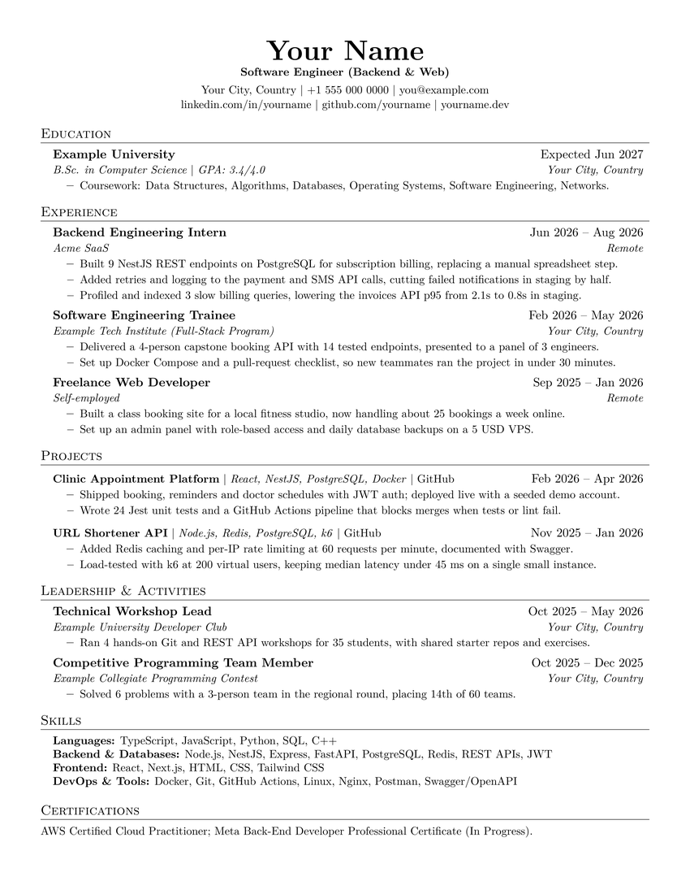
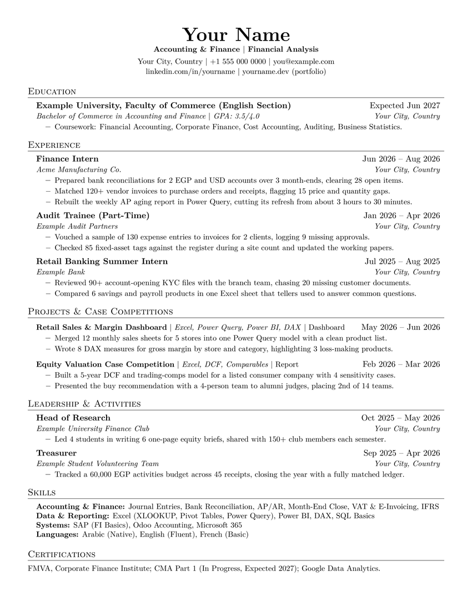

<div align="center">

<picture>
  <source media="(max-width: 767px) and (prefers-color-scheme: dark)" srcset="assets/banner-mobile-dark.svg">
  <source media="(max-width: 767px)" srcset="assets/banner-mobile-light.svg">
  <source media="(prefers-color-scheme: dark)" srcset="assets/banner-dark.svg">
  
</picture>

<p align="center">
  <a href="#-start-in-3-steps"></a>
  <a href="https://amrelsherif-eng.github.io/ats-resume-templates/#video"></a>
  <a href="#-pick-your-template"></a>
  <a href="https://github.com/amrelsherif-eng/ats-resume-templates"></a>
</p>

[](https://github.com/amrelsherif-eng/ats-resume-templates/actions/workflows/build.yml)
[](https://github.com/amrelsherif-eng/ats-resume-templates/actions/workflows/site.yml)
[](LICENSE)

**Free one-page LaTeX resumes for students and early-career candidates,<br>plus a website to edit them three ways and check your CV in the browser.**

[**Website**](https://amrelsherif-eng.github.io/ats-resume-templates/) · [**بالعربي**](https://amrelsherif-eng.github.io/ats-resume-templates/ar.html) · [**Video tutorials**](https://amrelsherif-eng.github.io/ats-resume-templates/#video) · [**CV checker**](https://amrelsherif-eng.github.io/ats-resume-templates/#check)

</div>

<a id="what-you-get"></a>
<a id="-table-of-contents"></a>
<a id="table-of-contents"></a>
<picture>
  <source media="(max-width: 767px)" srcset="assets/h-what-mobile.svg">
  
</picture>
<picture>
  <source media="(max-width: 767px)" srcset="assets/h-what-mobile-light.svg">
  
</picture>

<a href="https://amrelsherif-eng.github.io/ats-resume-templates/">
<picture>
  <source media="(max-width: 767px)" srcset="assets/cards-mobile.svg">
  
</picture>
<picture>
  <source media="(max-width: 767px)" srcset="assets/cards-mobile-light.svg">
  
</picture>
</a>

**Jump to:** [Templates](#-pick-your-template) · [Start in 3 steps](#-start-in-3-steps) · [Three ways to edit](#three-ways-to-edit) · [Check your CV](#check-your-cv) · [Videos](#-video-tutorials) · [ATS-friendly?](#-is-it-really-ats-friendly) · [Customize](#customize) · [Build locally](#-build-locally) · [Developers](#for-developers) · [FAQ](#faq) · [Changelog](#-changelog)

<a id="-pick-your-template"></a>
<a id="pick-your-template"></a>
<picture>
  <source media="(max-width: 767px)" srcset="assets/h-templates-mobile.svg">
  
</picture>
<picture>
  <source media="(max-width: 767px)" srcset="assets/h-templates-mobile-light.svg">
  
</picture>

Choose the track closest to the job you want. Every template is one page, uses fictional sample data, and comes as a `.tex` source, a ready PDF, and an Overleaf project.

<table>
  <tr>
    <td align="center" valign="top" width="33%">

**Network & Cloud**<br>
<sub>Network, NOC, Cloud, SysAdmin, Junior DevOps</sub>


[.tex](templates/network-cloud/resume.tex) · [PDF](templates/network-cloud/resume.pdf) · [**Overleaf**](https://www.overleaf.com/read/wxvvcdjzxnng#d23995)

</td>
    <td align="center" valign="top" width="33%">

**Embedded & ECE**<br>
<sub>Embedded, IoT, Instrumentation & Control</sub>


[.tex](templates/embedded-ece/resume.tex) · [PDF](templates/embedded-ece/resume.pdf) · [**Overleaf**](https://www.overleaf.com/read/rjnzhhzrhffz#dd0591)

</td>
    <td align="center" valign="top" width="33%">

**Mobile Apps**<br>
<sub>Flutter / mobile developers, student team leads</sub>


[.tex](templates/mobile-apps/resume.tex) · [PDF](templates/mobile-apps/resume.pdf) · [**Overleaf**](https://www.overleaf.com/read/ytqxjshntmfb#335363)

</td>
  </tr>
  <tr>
    <td align="center" valign="top" width="33%">

**Software Engineering**<br>
<sub>Backend, full-stack and web developers, CS students</sub>



[.tex](templates/software-web/resume.tex) · [PDF](templates/software-web/resume.pdf) · [**Overleaf**](https://www.overleaf.com/project/6ae24cbbb91643c3433bdf53/share#5c212b281201e2cd4d1433f0877a918fec537672141ba0e4)

</td>
    <td align="center" valign="top" width="33%">

**Business & Finance**<br>
<sub>Accounting, finance, audit, banking, Commerce students</sub>



[.tex](templates/business-finance/resume.tex) · [PDF](templates/business-finance/resume.pdf) · [**Overleaf**](https://www.overleaf.com/project/6ae24d2b537127bac7e70376/share#5cc2e5131e359736c6fb784a325e766dd439be52c846f976)

</td>
    <td align="center" valign="middle" width="33%">

**Your field next?**<br>
<sub>Missing your track?</sub>

[Request a template](https://github.com/amrelsherif-eng/ats-resume-templates/issues/new) and tell me which one.

</td>
  </tr>
</table>

<a id="-start-in-3-steps"></a>
<a id="start-in-3-steps"></a>
<picture>
  <source media="(max-width: 767px)" srcset="assets/h-start-mobile.svg">
  
</picture>
<picture>
  <source media="(max-width: 767px)" srcset="assets/h-start-mobile-light.svg">
  
</picture>

No LaTeX knowledge and nothing to install. [Overleaf](https://www.overleaf.com) turns the template into a PDF in your browser.

| Step | What to do |
|:---:|:---|
| **1** | Pick a template above and open its **Overleaf** link. Sign in with a free Overleaf account. |
| **2** | The shared project is read-only, so make your own copy: **File → Make a copy** (older layout: **Menu → Copy Project**). |
| **3** | Replace the sample text with yours, click **Recompile**, and download the PDF. |

> [!TIP]
> Prefer a blank project? Create one in Overleaf, open the template's **.tex** link above, and paste everything into `main.tex`.

<a id="three-ways-to-edit"></a>
<picture>
  <source media="(max-width: 767px)" srcset="assets/h-edit-mobile.svg">
  
</picture>
<picture>
  <source media="(max-width: 767px)" srcset="assets/h-edit-mobile-light.svg">
  
</picture>

| | Way | Best for | You need |
|:---:|:---|:---|:---|
| ☁️ | **Overleaf** | Most people | A free Overleaf account ([steps above](#-start-in-3-steps)) |
| 🤖 | **Any AI chat** | Filling the template fast from your old CV | ChatGPT, Gemini or Claude, then Overleaf to compile |
| 💻 | **Locally** | People who already use LaTeX | A LaTeX install, or Docker ([setup below](#-build-locally)) |

<a id="-let-ai-fill-it-in"></a>
**Let AI fill it in.** Copy the whole `resume.tex`, paste it into the chat with this prompt, then paste the code it returns into Overleaf:

```text
Fill this LaTeX resume template with my information below.
Rules: keep it to ONE page, keep every LaTeX command and the layout unchanged,
use only the facts I give you (do not invent numbers, tools or results),
start each bullet with an action verb, and list experience newest first.

My information:
[paste your details, old CV, or LinkedIn "About" and "Experience" here]
```

> [!IMPORTANT]
> Read every line before you send the CV. You will be asked about it in the interview.

<a id="check-your-cv"></a>
<a id="check-your-cv-on-the-website"></a>
<picture>
  <source media="(max-width: 767px)" srcset="assets/h-check-mobile.svg">
  
</picture>
<picture>
  <source media="(max-width: 767px)" srcset="assets/h-check-mobile-light.svg">
  
</picture>

Drop any PDF into the [**CV checker**](https://amrelsherif-eng.github.io/ats-resume-templates/#check). You get a score out of 100, what passed, what to fix first, and the exact text an ATS would extract. One click turns the report into a fix-it prompt for an AI chat.

| It checks | For example |
|:---|:---|
| **Text** | Can the text be extracted at all, and in a sensible reading order? |
| **Length** | Page count against the experience level you choose |
| **Layout** | Columns, table-like layouts, images, icons, contact details hidden in headers or footers |
| **File** | Font variety, file name, file size |
| **Content** | Standard sections, email, phone, LinkedIn, location |
| **Bullets** | Action verbs, weak openings, length, measurable results |

> [!NOTE]
> **Private by design.** The PDF is read inside your browser and never uploaded. No accounts, no trackers, no third-party requests.
> It checks how readable your PDF is. It does **not** match you to a job post; for that, try [Jobscan](https://www.jobscan.co/) or [Resume Worded](https://resumeworded.com/) (they upload your file).

<a id="-video-tutorials"></a>
<a id="video-tutorials"></a>
<a id="-video-tutorial-2-min"></a>
<a id="video-tutorial-2-min"></a>
<picture>
  <source media="(max-width: 767px)" srcset="assets/h-video-mobile.svg">
  
</picture>
<picture>
  <source media="(max-width: 767px)" srcset="assets/h-video-mobile-light.svg">
  
</picture>

| Video | Length | Language |
|:---|:---:|:---|
| [**Full tutorial**](https://amrelsherif-eng.github.io/ats-resume-templates/#video) | 5:15 | English voice-over + on-screen subtitles |
| [**الشرح الكامل**](https://amrelsherif-eng.github.io/ats-resume-templates/ar.html#video) | 5:02 | Egyptian Arabic voice-over + subtitles |
| [**Quick demo**](https://amrelsherif-eng.github.io/ats-resume-templates/#video) | 0:41 | English + Arabic captions |

The full tutorial has chapter buttons on the site: **Pick a template · Edit on Overleaf · Edit with AI · Build it locally · Check your CV**.

> 📣 The project launched on LinkedIn, where the [release post](https://www.linkedin.com/feed/update/urn:li:share:7463276669491937281) reached **12K+ impressions**.

<a id="-is-it-really-ats-friendly"></a>
<a id="is-it-really-ats-friendly"></a>
<a id="-why-these-templates"></a>
<picture>
  <source media="(max-width: 767px)" srcset="assets/h-ats-mobile.svg">
  
</picture>
<picture>
  <source media="(max-width: 767px)" srcset="assets/h-ats-mobile-light.svg">
  
</picture>

An ATS (applicant tracking system) reads your PDF as text before a person sees it. If it cannot read the text, or the text comes out in the wrong order, your CV can be skipped.

| Common trap | How these templates avoid it |
|:---|:---|
| **Unreadable PDF** | `\pdfgentounicode=1`, standard fonts, single column. No layout tables, text boxes, images or icons. |
| **Two pages too soon** | Margins and spacing tuned so an early-career background fits on exactly one page. |
| **Messy code** | Reusable commands (`\resumeItem`, `\resumeSubheading`) and labelled sections, so you edit text, not layout. |
| **Wrong things stand out** | Five tracks, each ordering sections and projects for that kind of role. |

**Checked on every change:** GitHub Actions builds all five templates and fails if a PDF is longer than one page, has fewer than 200 extractable words, or loses its sample text. No template can promise how every ATS behaves, so check your own PDF on the [website](https://amrelsherif-eng.github.io/ats-resume-templates/#check) or with `pdftotext -layout resume.pdf -`.

> [!WARNING]
> Avoid photos, columns, text inside images, contact details in headers or footers, and decorative fonts.

<a id="customize"></a>
<a id="-customize"></a>
<picture>
  <source media="(max-width: 767px)" srcset="assets/h-custom-mobile.svg">
  
</picture>
<picture>
  <source media="(max-width: 767px)" srcset="assets/h-custom-mobile-light.svg">
  
</picture>

<details>
<summary><b>Customize the template</b> (paper size, font, role line, sections)</summary>

**A4 instead of US Letter**

```latex
\documentclass[a4paper,11pt]{article}
```

**Another font** (default is Latin Modern, `\usepackage{lmodern}`):

```latex
\usepackage{charter}
```

**The role line under your name** (write `&` as `\&` in LaTeX):

```latex
\small \textbf{Cloud Infrastructure \& Network Engineer}
```

**Sections:** rename with `\section{New Name}`; move or delete the block between its `%-----------` markers. Add an entry with the existing commands:

```latex
\section{Volunteer Experience}
\resumeSubHeadingListStart
  \resumeSubheading{Community Mentor}{Oct 2025 -- Present}{Local Tech Club}{Your City, Country}
  \resumeItemListStart
    \resumeItem{Mentored 10 students in foundational programming and Git workflows.}
  \resumeItemListEnd
\resumeSubHeadingListEnd
```

</details>

<details>
<summary><b>Writing tips</b></summary>

- One idea per bullet: action, task, and result or scope.
- Use only numbers you can explain in an interview.
- Use the job post's wording for skills and tools when it is true for you.
- Newest experience first. Keep the PDF text selectable.
- Keep a tailored copy for each kind of role.
- Students and early-career candidates: one page.

</details>

<a id="-build-locally"></a>
<a id="build-locally"></a>
<picture>
  <source media="(max-width: 767px)" srcset="assets/h-build-mobile.svg">
  
</picture>
<picture>
  <source media="(max-width: 767px)" srcset="assets/h-build-mobile-light.svg">
  
</picture>

```bash
git clone https://github.com/amrelsherif-eng/ats-resume-templates.git
cd ats-resume-templates/templates/network-cloud
latexmk -pdf resume.tex
```

<details>
<summary><b>Setup: VS Code + LaTeX</b> (Windows, Linux, macOS)</summary>

| Tool | Purpose |
|:---|:---|
| [VS Code](https://code.visualstudio.com/) | Editor |
| [LaTeX Workshop](https://marketplace.visualstudio.com/items?itemName=James-Yu.latex-workshop) | Builds and previews the PDF inside VS Code |
| [MiKTeX](https://miktex.org/download) | LaTeX for Windows (allow it to install missing packages) |
| [Strawberry Perl](https://strawberryperl.com/) | Needed by `latexmk` on Windows |

Linux: `sudo apt install texlive-latex-extra latexmk`. macOS: `brew install --cask mactex-no-gui`.

In VS Code, **Ctrl+Alt+B** builds and **Ctrl+Alt+V** opens the PDF. Recommended settings:

```jsonc
{
  "latex-workshop.view.pdf.viewer": "tab",
  "latex-workshop.latex.autoBuild.run": "onSave"
}
```

The first MiKTeX build downloads missing packages, so it needs an internet connection.

</details>

<details>
<summary><b>No install: Docker</b></summary>

```bash
docker run --rm -v "$PWD":/work -w /work/templates/network-cloud texlive/texlive:latest latexmk -pdf resume.tex
```

</details>

<a id="for-developers"></a>
<a id="-project-structure"></a>
<picture>
  <source media="(max-width: 767px)" srcset="assets/h-dev-mobile.svg">
  
</picture>
<picture>
  <source media="(max-width: 767px)" srcset="assets/h-dev-mobile-light.svg">
  
</picture>

```text
templates/           5 templates: resume.tex, resume.pdf, preview.png
site/                the website: index.html, assets/ (checker in assets/ats/), build.py, tests/
.github/workflows/   build.yml (templates), site.yml (site tests), pages.yml (deploy)
assets/              README graphics
```

| Quality check | Result |
|:---|:---|
| Lighthouse (English page) | 100 performance · accessibility · best practices · SEO, mobile and desktop |
| Accessibility | WCAG AA, tested with axe-core on every change |
| Security | Strict Content-Security-Policy, no third-party requests, self-hosted fonts and pdf.js |
| Browsers | Tested in Chromium (Edge), Firefox and WebKit |
| Tests | Layout at phone, tablet and desktop sizes, links, the checker on real PDFs, English and Arabic pages |

<details>
<summary><b>Build and test the website locally</b></summary>

```bash
npm ci --prefix site && python site/build.py _site
SITE_DIR=_site BROWSER_CHANNEL=msedge AXE_PATH=site/node_modules/axe-core/axe.min.js python -m pytest site/tests -q
```

Bash syntax (Linux, macOS, Git Bash). In PowerShell, set each variable first, for example `$env:SITE_DIR = "_site"`. The tests need Python with Playwright and pytest. Leave out `BROWSER_CHANNEL` to use Playwright's own Chromium.

</details>

<a id="faq"></a>
<a id="-faq"></a>
<picture>
  <source media="(max-width: 767px)" srcset="assets/h-faq-mobile.svg">
  
</picture>
<picture>
  <source media="(max-width: 767px)" srcset="assets/h-faq-mobile-light.svg">
  
</picture>

<details>
<summary><b>US Letter or A4?</b></summary>

US Letter for the United States and Canada; A4 for the UK, Europe, the Middle East and most other places. Switch with `a4paper` (see [Customize](#customize)).
</details>

<details>
<summary><b>Can I add a photo?</b></summary>

Photos, columns and text boxes can confuse an ATS. If a job post asks for a photo, upload the PDF to the portal and send a photo only if a recruiter asks.
</details>

<details>
<summary><b>Can my resume be two pages?</b></summary>

For students, interns and early-career candidates, aim for one page. With more experience, a second page is fine if every line earns its place. Pick your experience level in the checker.
</details>

<details>
<summary><b>My name has accents or non-English letters.</b></summary>

Common accents work as they are (`\'e` gives é). For other scripts, switch the compiler to XeLaTeX (Overleaf: **Menu → Settings → Compiler**; locally: `latexmk -xelatex`) and add `\usepackage{fontspec}`. `fontspec` does not work with the default pdfLaTeX.
</details>

<details>
<summary><b>Is there an Arabic version?</b></summary>

The website, yes: a full right-to-left [Arabic page](https://amrelsherif-eng.github.io/ats-resume-templates/ar.html) that Arabic-language browsers open automatically, and a full tutorial in Egyptian Arabic. The templates are English, left-to-right, for jobs that hire in English.
</details>

<details>
<summary><b>Why LaTeX instead of Word or Google Docs?</b></summary>

LaTeX gives exact control over spacing and page layout, and the PDF it produces is clean text. With Overleaf you edit the sample text without learning LaTeX first.
</details>

<details>
<summary><b>Can I use the templates commercially?</b></summary>

Yes. They are MIT licensed: use, change and share them, for personal or commercial use, keeping the license notice.
</details>

<details>
<summary><b>How do I keep my phone number private?</b></summary>

If you put your CV in a public GitHub repository, replace your phone number and street address with placeholders, or show only your city and professional links.
</details>

<a id="-changelog"></a>
<a id="changelog"></a>
<a id="-license--credits"></a>
<a id="license--credits"></a>
<picture>
  <source media="(max-width: 767px)" srcset="assets/h-more-mobile.svg">
  
</picture>
<picture>
  <source media="(max-width: 767px)" srcset="assets/h-more-mobile-light.svg">
  
</picture>

<details>
<summary><b>Changelog</b></summary>

- **v2.5 (Oct 2026):** Redesigned video section (full tutorial in English and Arabic, chapters, language switch), pre-rendered Arabic page with `hreflang`, faster Arabic first load.
- **v2.4 (Oct 2026):** Full video tutorial on the website (5 min, English and Arabic), replacing the old 2-minute walkthrough.
- **v2.3 (Oct 2026):** Website redesign (calmer visuals, smoother motion, animated score gauge), a 20-case test corpus for the checker, GitHub Sponsors.
- **v2.2 (Oct 2026):** Website with a template gallery, the in-browser ATS check (scored report, fixes, experience-aware page rules), English and Arabic, automated site tests.
- **v2.1 (Oct 2026):** Software Engineering and Business & Finance templates, with Overleaf links. Mobile Apps sample filled to a full page.
- **v2.0 (Oct 2026):** Three role-focused templates, inline quick-guide comments, Leadership & Activities section, CI build checks, rewritten documentation.
- **v1.0 (May 2026):** First public release: one template, Overleaf link, AI prompt.

</details>

**Support.** Everything here is free. If it helped you, you can [sponsor the work on GitHub](https://github.com/sponsors/amrelsherif-eng), star the repo, or share it with a friend. Monthly backers ($5+) are thanked here by name.
<!-- When the first $5+ monthly backer joins, replace the next line with their name or @handle. Add more backers comma-separated. -->
*No supporters yet. [Be the first!](https://github.com/sponsors/amrelsherif-eng)* 💙

**Contributing.** Issues and pull requests are welcome. To add a role template: copy a folder under `templates/`, keep the preamble and commands, use fictional data (`Your Name`, `example.com`), and make sure the PDF stays one page and passes the CI build.

**License & credits.** MIT, see [LICENSE](LICENSE). Copyright © 2026 Amr Fathy Elsherif. Built on the open-source [sb2nov/resume](https://github.com/sb2nov/resume) by Sourabh Bajaj (MIT).

---

<div align="center">

**Amr Fathy Elsherif** · Network & Cloud Infrastructure

[](https://github.com/amrelsherif-eng)
[](https://www.linkedin.com/in/amrelsherif-eng)
[](https://amrelsherif-eng.vercel.app)

*If these templates helped you, a ⭐ on the repo helps others find them.*

</div>
