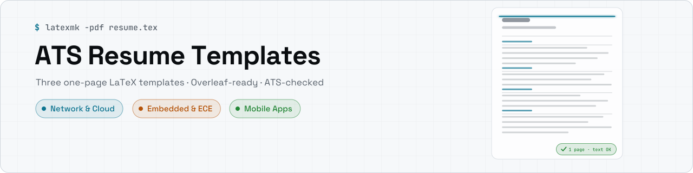
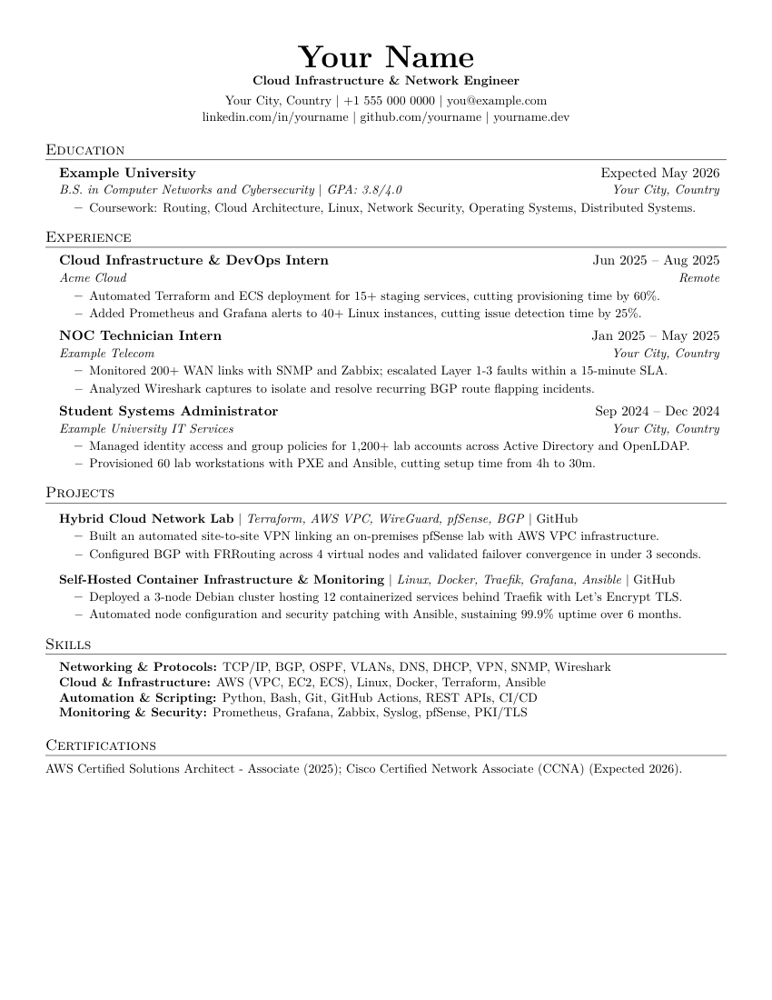
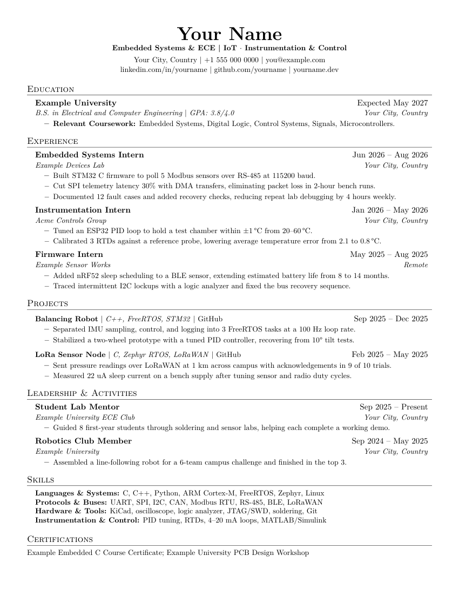
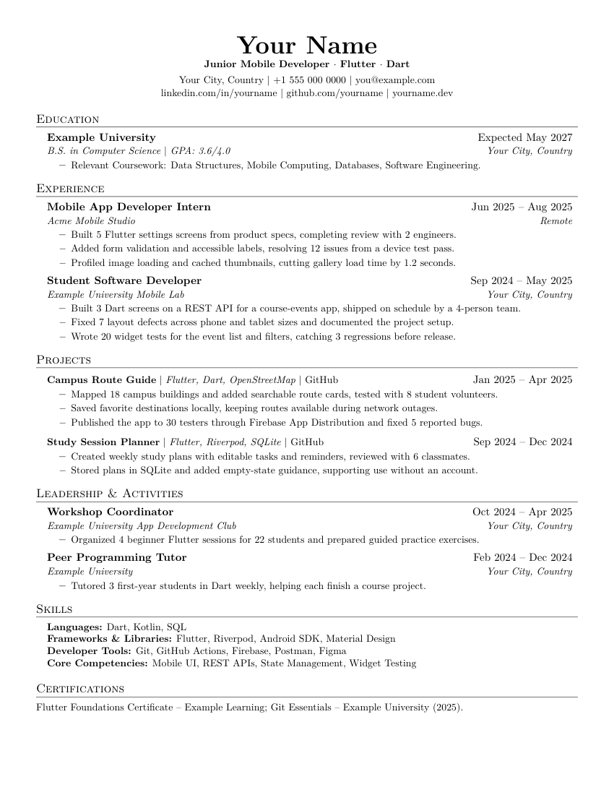

<div align="center">

<picture>
  <source media="(max-width: 767px) and (prefers-color-scheme: dark)" srcset="assets/banner-mobile-dark.svg">
  <source media="(max-width: 767px)" srcset="assets/banner-mobile-light.svg">
  <source media="(prefers-color-scheme: dark)" srcset="assets/banner-dark.svg">
  
</picture>

<p align="center">
  <a href="#-start-in-3-steps"></a>
  <a href="https://www.linkedin.com/feed/update/urn:li:ugcPost:7500210253041508354"></a>
  <a href="#-pick-your-template"></a>
  <a href="https://github.com/amrelsherif-eng/ats-resume-templates/stargazers"></a>
</p>

[](https://github.com/amrelsherif-eng/ats-resume-templates/actions/workflows/build.yml)
[](https://opensource.org/licenses/MIT)
[](https://www.latex-project.org/)
[](#-start-in-3-steps)
[](#-pick-your-template)
[](#-is-it-really-ats-friendly)

<p align="center">
Free, one-page, ATS-friendly resumes for students and early-career engineers. Pick a template, copy it on Overleaf, replace the sample text, download your PDF.
</p>

</div>

---

<a id="-pick-your-template"></a>
<a id="pick-your-template"></a>
## 🗂️ Pick Your Template

Choose the template tailored to your engineering path and career goals.

<table>
  <tr>
    <td align="center" valign="top" width="33%">

**Network & Cloud**  
**Best for:** Network, NOC, Cloud, SysAdmin, Junior DevOps  
**Sample highlights:** Terraform, Zabbix, BGP lab



[.tex](templates/network-cloud/resume.tex) · [PDF](templates/network-cloud/resume.pdf) · [Overleaf](https://www.overleaf.com/read/wxvvcdjzxnng#d23995)

</td>
    <td align="center" valign="top" width="33%">

**Embedded & ECE**  
**Best for:** Embedded, IoT, Instrumentation & Control, electronics students  
**Sample highlights:** STM32, PID, LoRaWAN



[.tex](templates/embedded-ece/resume.tex) · [PDF](templates/embedded-ece/resume.pdf) · [Overleaf](https://www.overleaf.com/read/rjnzhhzrhffz#dd0591)

</td>
    <td align="center" valign="top" width="33%">

**Mobile Apps**  
**Best for:** Flutter / mobile developers, student team leads  
**Sample highlights:** Flutter, BLoC, widget tests



[.tex](templates/mobile-apps/resume.tex) · [PDF](templates/mobile-apps/resume.pdf) · [Overleaf](https://www.overleaf.com/read/ytqxjshntmfb#335363)

</td>
  </tr>
</table>

---

<a id="-start-in-3-steps"></a>
<a id="start-in-3-steps"></a>
## 🚀 Start in 3 Steps (no LaTeX needed)

You can create an editable copy and download your finished PDF directly in your web browser.

1. **Pick** the template that matches the job you want ([see above](#-pick-your-template)).
2. **Open it in Overleaf** and click **`File` → `Make a copy`** (free account required).
3. **Replace the sample text** with your own details, or let an AI fill it for you ([prompt below](#-let-ai-fill-it-in)), then click **Recompile** and download your PDF.

> All three templates contain **fictional sample data** ("Your Name", example.com). Nothing in them is a real person's CV.

<details>
<summary>Show the Overleaf steps with screenshots-free instructions</summary>

<br>

> ⚠️ **The public template links are READ-ONLY.** You cannot edit the public project directly. Follow one of the two methods below to create an editable copy in your free account.

### Method 1 — Copy Project (Fastest)

> **Prerequisite:** You must have a free [Overleaf account](https://www.overleaf.com/register) and be **logged in** before opening the link.

1. Open the Overleaf link for your chosen template:
   - [Network & Cloud on Overleaf](https://www.overleaf.com/read/wxvvcdjzxnng#d23995)
   - [Embedded & ECE on Overleaf](https://www.overleaf.com/read/rjnzhhzrhffz#dd0591)
   - [Mobile Apps on Overleaf](https://www.overleaf.com/read/ytqxjshntmfb#335363)
2. In the **top-left menu bar**, click **`File`**.
3. Select **`Make a copy`** from the dropdown.
4. A **"Copy project"** dialog will appear — rename the project if you like, then click the green **`Copy`** button.
5. Overleaf clones the full template into your account. Click **Recompile** and start editing `resume.tex`. ✓

### Method 2 — Blank Project + Paste

1. Create a **New Blank Project** on [overleaf.com](https://www.overleaf.com).
2. Open `templates/<template>/resume.tex` in this repository and **copy the full raw source**.
3. **Paste** it into the `main.tex` file of your blank Overleaf project.
4. Click **Recompile** — done. ✓

</details>

---

<a id="-video-tutorial-2-min"></a>
<a id="video-tutorial-2-min"></a>
## 🎥 Video Tutorial (2 min)

Watch a two-minute walkthrough showing how to edit and compile your resume.

A two-minute walkthrough of the three ways to edit a template: with AI, on Overleaf, or locally.

**[▶ Watch on LinkedIn](https://www.linkedin.com/feed/update/urn:li:ugcPost:7500210253041508354)** · [Download the MP4](docs/video-tutorial.mp4)

> 📣 First released on LinkedIn, where the launch post reached **12K+ impressions**. [Read the release post](https://www.linkedin.com/feed/update/urn:li:share:7463276669491937281) and share it with anyone preparing for internships or their first job.

---

<a id="-table-of-contents"></a>
<a id="table-of-contents"></a>
## 📑 Table of Contents

Jump directly to any section below.

- [🤖 Let AI Fill It In](#-let-ai-fill-it-in)
- [✨ Why These Templates](#-why-these-templates)
- [🎨 Customize](#-customize)
- [✍️ Writing Tips](#-writing-tips)
- [✅ Is It Really ATS-Friendly?](#-is-it-really-ats-friendly)
- [🖥️ Build Locally](#-build-locally)
- [📁 Project Structure](#-project-structure)
- [❓ FAQ](#-faq)
- [🗒️ Changelog](#-changelog)
- [🤝 Contributing](#-contributing)
- [📜 License & Credits](#-license--credits)

---

<a id="-let-ai-fill-it-in"></a>
<a id="let-ai-fill-it-in"></a>
## 🤖 Let AI Fill It In

You do not need to learn LaTeX syntax to fill out your resume.

Copy the full contents of your chosen `resume.tex`, paste it into **Gemini**, **ChatGPT**, or **Claude**, and use this prompt:

```text
Fill this LaTeX resume template with my information below.
Rules: keep it to ONE page, keep every LaTeX command and the layout unchanged,
use only the facts I give you (do not invent numbers, tools or results),
start each bullet with an action verb, and list experience newest first.

My information:
[paste your details, old CV, or LinkedIn "About" and "Experience" here]
```

Paste the result back into Overleaf and click **Recompile**. Read every line before you send it: you are the one who will be asked about it in the interview.

---

<a id="-why-these-templates"></a>
<a id="why-these-templates"></a>
## ✨ Why These Templates

These templates solve the common formatting traps that cause resumes to get discarded by automated screeners.

Recruiters skim a resume in seconds, and companies frequently run submissions through an Applicant Tracking System (ATS) first. A resume that a machine cannot parse, or that spills onto two pages, often never reaches a hiring manager.

| Key Feature | Challenge | How These Templates Handle It |
|:---|:---|:---|
| **`[01]` One-Page Layout** | Resume too long | Margins, spacing, and line heights are strictly tuned so an early-career engineer's full background fits on exactly one page. |
| **`[02]` ATS-Readable PDF** | ATS cannot read it | Uses `\pdfgentounicode=1`, standard T1 fonts, and single-column text. No tables for layout, text boxes, images, or icons. Each template was verified with text extraction before release. |
| **`[03]` Clean Code Architecture** | Overdesigned layouts | Built with reusable macros (`\resumeItem`, `\resumeSubheading`, `\resumeProjectHeading`), labelled section markers, and no unused packages. Clean typographic hierarchy with no columns or visual noise. |
| **`[04]` Easy Customization** | Hard to customize | Content lives in clearly labelled blocks. You swap your info without touching the underlying structural code. |
| **`[05]` Three Role-Focused Versions** | Wrong things stand out | Three distinct tracks order and emphasize relevant technical sections, projects, and coursework for specific career paths. |

---

<a id="-customize"></a>
<a id="customize"></a>
## 🎨 Customize

You can customize layout settings, typography, and section order with a few small edits.

### Switch to A4 paper
Templates default to US Letter (`letterpaper`). To switch to standard international A4 paper, update line 21:

```latex
\documentclass[a4paper,11pt]{article}
```

### Change the font
Templates default to Latin Modern (`\usepackage{lmodern}`). To use another standard font, replace that package in the preamble (for example, with Charter):

```latex
\usepackage{charter}
```

### Change the target role
Update the role line under your name in the heading block:

```latex
\small \textbf{Cloud Infrastructure \& Network Engineer}
```

### Rename, reorder, or remove a section
- **Rename:** Change the text inside the section command: `\section{New Section Name}`.
- **Reorder:** Cut and paste the entire block from its `%-----------` comment to the next marker.
- **Remove:** Delete the block between the section's `%-----------` comments.

### Add a new section
Use the built-in macros to create a new section with matching typography:

```latex
\section{Volunteer Experience}
\resumeSubHeadingListStart
  \resumeSubheading{Community Mentor}{Oct 2025 -- Present}{Local Tech Club}{Your City, Country}
  \resumeItemListStart
    \resumeItem{Mentored 10 students in foundational programming and Git workflows.}
  \resumeItemListEnd
\resumeSubHeadingListEnd
```

Every template organizes content using consistent, labelled section comments:

```latex
%----------- HEADING: name, target role, contact links
%----------- EDUCATION: degree, GPA (if 3.0+), relevant coursework
%----------- EXPERIENCE: newest first, 2-3 bullets each (action verb + task + result)
%----------- PROJECTS: 2 projects, tech stack in the heading, link to the code
%----------- LEADERSHIP & ACTIVITIES: clubs, teaching, volunteering, competitions
%----------- SKILLS: 4 grouped lines, most relevant first
%----------- CERTIFICATIONS: one line, separated by semicolons
```

| To do this | Use |
|:---|:---|
| Add a job, degree or activity | `\resumeSubheading{Title}{Dates}{Organization}{Location}` |
| Add a project | `\resumeProjectHeading{\textbf{Name} $\|$ \emph{Tech} $\|$ \href{URL}{GitHub}}{Dates}` |
| Add a bullet | `\resumeItem{Action verb + what you did + result}` |
| Remove a section | Delete from its `%-----------` marker to the next one |

---

<a id="-writing-tips"></a>
<a id="writing-tips"></a>
## ✍️ Writing Tips

Strong resume bullets focus on clear actions and verifiable results.

- **One idea per bullet:** action verb + what you did + the result or scope ("Configured VLANs and OSPF for a 3-site lab").
- **Only numbers you can explain.** A measured result beats an impressive guess.
- **Mirror the job post.** Use the same words for tools and skills that the posting uses, if they are true for you.
- **Newest first, one page, no photo.** Keep the PDF's text selectable and send it as PDF, not Word, unless asked.
- **One template per direction.** Applying to cloud and to mobile roles? Keep one tailored file for each.

---

<a id="-is-it-really-ats-friendly"></a>
<a id="is-it-really-ats-friendly"></a>
## ✅ Is It Really ATS-Friendly?

An ATS-friendly resume ensures automated applicant screening software can extract your text without errors.

Applicant Tracking Systems (ATS) parse uploaded PDF documents into plain text to index candidates. When resumes use multi-column layouts, tables for positioning, floating text boxes, graphics, or custom non-standard fonts, the parser extracts scrambled text, misplaced contact info, or blank fields. These templates use a single-column layout, standard T1 fonts, and `\pdfgentounicode=1` to guarantee clean Unicode text extraction.

### How it is verified
Every push compiles all three templates automatically in GitHub Actions CI. The automated test pipeline fails if:
1. The output PDF is not **exactly one page** (verified using `pdfinfo`).
2. The document text cannot be extracted cleanly or has fewer than 200 readable words (verified using `pdftotext`).

### How you can check your own PDF
Run this command in your terminal to see the exact text an ATS parser reads:

```bash
pdftotext -layout resume.pdf - | less
```

If your output displays clean text in logical reading order without missing sections or jumbled columns, the ATS parser will read it cleanly too.

### What to avoid
To keep your resume fully ATS-friendly, do not include:
- **Photos or headshots** (not recommended for ATS and unnecessary for tech roles)
- **Tables for layout** (parsers read across table rows rather than down columns)
- **Text inside images** (invisible to text parsers)
- **Headers or footers with contact details** (many parsers skip header and footer regions entirely)
- **Decorative or non-standard fonts** (can corrupt character encoding during extraction)

---

<a id="-build-locally"></a>
<a id="build-locally"></a>
## 🖥️ Build Locally

You can compile your resume on your local machine with full editor tooling, a command line, or Docker.

### Prerequisites

| Tool | Purpose |
|:---|:---|
| [VS Code](https://code.visualstudio.com/) | Editor / IDE |
| [LaTeX Workshop](https://marketplace.visualstudio.com/items?itemName=James-Yu.latex-workshop) | VS Code extension — build, preview, SyncTeX |
| [MiKTeX](https://miktex.org/download) | LaTeX compiler + auto package manager (Windows) |
| [Strawberry Perl](https://strawberryperl.com/) | Required by the `latexmk` build tool (Windows) |

On **Linux**, install TeX Live and latexmk (e.g. `sudo apt install texlive-latex-extra latexmk`).  
On **macOS**, install MacTeX (e.g. `brew install --cask mactex-no-gui`).

### Steps

```bash
# 1. Clone the repo
git clone https://github.com/amrelsherif-eng/ats-resume-templates.git
cd ats-resume-templates

# 2. Open in VS Code
code .
```

- Open the template folder you want, e.g. `templates/network-cloud/resume.tex`, and build it.
- On Windows, install **MiKTeX** → during setup, set missing packages to **"Install on-the-fly → Always"**.
- Install **Strawberry Perl** → verify with `perl --version`.
- Install the **LaTeX Workshop** extension in VS Code.

```
Ctrl+Alt+B  →  Build PDF
Ctrl+Alt+V  →  Open PDF preview
```

> On first build, MiKTeX auto-downloads any missing packages. Requires an internet connection.

### Recommended settings.json

```jsonc
{
  "latex-workshop.view.pdf.viewer": "tab",
  "latex-workshop.latex.autoBuild.run": "onSave"
}
```

### Build from a terminal

```bash
cd templates/network-cloud
latexmk -pdf resume.tex      # or: pdflatex resume.tex
```

### With Docker (no install)

Compile your resume using an isolated TeX Live Docker container without installing local LaTeX tools:

```bash
docker run --rm -v "$PWD":/work -w /work/templates/network-cloud texlive/texlive:latest latexmk -pdf resume.tex
```

---

<a id="-project-structure"></a>
<a id="project-structure"></a>
## 📁 Project Structure

The repository contains three role-specific templates, documentation assets, and automated build workflows.

```
ats-resume-templates/
├── .github/
│   └── workflows/
│       └── build.yml      ← GitHub Actions CI pipeline
├── assets/                ← README graphics, banners, and buttons
├── docs/
│   └── video-tutorial.mp4 ← 2-minute walkthrough video
├── templates/
│   ├── network-cloud/
│   │   ├── resume.tex     ← LaTeX source
│   │   ├── resume.pdf     ← Compiled PDF sample
│   │   └── preview.png    ← Preview thumbnail
│   ├── embedded-ece/
│   │   ├── resume.tex
│   │   ├── resume.pdf
│   │   └── preview.png
│   └── mobile-apps/
│       ├── resume.tex
│       ├── resume.pdf
│       └── preview.png
├── resume.tex             ← Copy of Network & Cloud (legacy links)
├── resume.pdf             ← Copy of Network & Cloud
├── .gitignore             ← Ignores LaTeX aux files
├── LICENSE
└── README.md
```

---

<a id="-faq"></a>
<a id="faq"></a>
## ❓ FAQ

Answers to common questions about layout, compatibility, and privacy.

<details>
<summary>Should I use US Letter or A4 paper?</summary>

US Letter (`letterpaper`) is standard in the United States and Canada. A4 (`a4paper`) is standard in the UK, Europe, the Middle East, and most other regions. Change `\documentclass[letterpaper,11pt]{article}` to `\documentclass[a4paper,11pt]{article}` on line 21 to switch.
</details>

<details>
<summary>Can I add a photo to my resume?</summary>

Photos are not recommended for ATS-friendly resumes. They increase file size, can cause parsing issues with automated screeners, and are generally avoided in tech hiring to prevent unconscious bias.
</details>

<details>
<summary>Can my resume be two pages?</summary>

For students, interns, and early-career engineers with under five years of experience, a single page is standard. If your text spills onto a second page, tighten bullet phrasing or remove older coursework before shrinking margins.
</details>

<details>
<summary>What if my name contains non-English characters or accents?</summary>

If your name includes special accents or non-English characters, compile using **XeLaTeX** or **LuaLaTeX** and add `\usepackage{fontspec}` in your preamble.
</details>

<details>
<summary>Is this template free for commercial use?</summary>

Yes. All templates are licensed under the permissive **MIT License**. You may freely use, modify, and distribute them for personal and commercial applications.
</details>

<details>
<summary>Why use LaTeX instead of Microsoft Word or Google Docs?</summary>

LaTeX provides precise typographic control, deterministic margins, consistent spacing, and clean text extraction. Word processors frequently shift spacing, change page counts across different devices, or export malformed text streams.
</details>

<details>
<summary>How do I keep my phone number private on public copies?</summary>

If you commit your resume to a public GitHub repository, replace your phone number and full street address with placeholders, or display only your general city, LinkedIn, and GitHub links.
</details>

---

<a id="-changelog"></a>
<a id="changelog"></a>
## 🗒️ Changelog

Release history and template improvements across versions.

- **v2.0 (Oct 2026):** Three role-focused templates, inline quick-guide comments, Leadership & Activities section, GitHub Actions CI build checks, and rewritten documentation.
- **v1.0 (May 2026):** First public release of the single template with Overleaf integration, GitHub repository, and AI prompt.

---

<a id="-contributing"></a>
<a id="contributing"></a>
## 🤝 Contributing

Community contributions and suggestions are welcome.

Feel free to open an issue or submit a pull request. To contribute a new role template:
1. Copy an existing folder under `templates/` (for example, `templates/network-cloud/`).
2. Keep the core preamble and custom macros consistent.
3. Use fictional sample data (`Your Name`, `example.com`).
4. Ensure the compiled PDF fits on exactly one page and passes the GitHub Actions CI checks.

---

<a id="-license--credits"></a>
<a id="license--credits"></a>
## 📜 License & Credits

Released under the **MIT License** — free to use, modify, and distribute.

```
MIT License © 2026 Amr Fathy Elsherif
```

> This template is **heavily customized and optimized** by **Amr Fathy Elsherif**, built upon the original open-source base by [**sb2nov**](https://github.com/sb2nov/resume) (MIT License).

---

<div align="center">

**Amr Fathy Elsherif** · Network & Cloud Infrastructure

[](https://github.com/amrelsherif-eng)
[](https://www.linkedin.com/in/amrelsherif-eng)
[](https://amrelsherif-eng.vercel.app)

*If this template helped you, a ⭐ on the repo helps others find it.*

</div>
